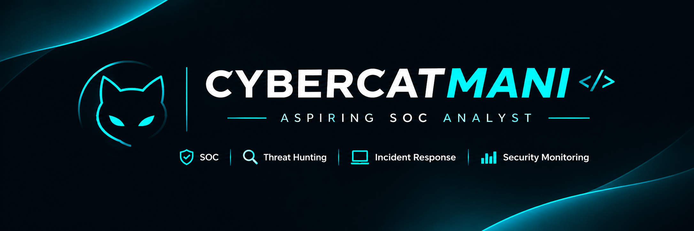

<div align="center">
  
</div>

---

<div align="center">

# ⚡ CYBERCATMANI

### `ASPIRING SOC ANALYST | CYBERSECURITY ENTHUSIAST`


<br/>

[](https://cybercatmani.github.io/)
[](https://github.com/cybercatmani)

</div>

---

## 👨‍💻 ABOUT ME

```bash
Name       : Manikandan P
Role       : Aspiring SOC Analyst
Focus      : Cybersecurity & Blue Team Operations
Learning   : SIEM, Threat Detection, Incident Response
Goal       : Become a skilled Cybersecurity Professional
```

- 🔐 Passionate about cybersecurity and defensive security.
- 🛡️ Building hands-on SOC Analyst projects.
- 🔍 Exploring security monitoring and threat investigation.
- 💻 Learning through practical labs and real-world scenarios.
- 🚀 Always learning, building and improving.

---

## 🛠️ TECH STACK & TOOLS

<div align="center">


</div>

### 🔐 Cybersecurity Tools

- SIEM: Wazuh
- Endpoint Monitoring: Sysmon
- Network Security: Suricata
- Log Analysis: Windows Event Logs

---


## 🚀 FEATURED PROJECTS

### 🛡️ 1. Enterprise SOC Lab
A hands-on enterprise security operations lab.

[📂 Explore Project](https://github.com/cybercatmani/cybersecurity-projects/tree/main/enterprise-soc-lab)

### 🔍 2. SOC Sentinel
A cybersecurity project focused on SOC operations.

[📂 Explore Project](https://github.com/cybercatmani/cybersecurity-projects/tree/main/soc-sentinel)

### 🚨 3. Threat Hunting & IR Automation
A project focused on threat hunting and incident response automation.

[📂 Explore Project](https://github.com/cybercatmani/cybersecurity-projects/tree/main/threat-hunting-ir-automation)

---

📁 All three projects are available in my
[Cybersecurity Projects Repository](https://github.com/cybercatmani/cybersecurity-projects).


---

## 📊 GITHUB STATISTICS

<div align="center">


</div>

---

## 🎯 CURRENT FOCUS

- Strengthening networking and Linux fundamentals.
- Learning SIEM and security event analysis.
- Building practical SOC Analyst projects.
- Improving Python scripting skills.
- Preparing for cybersecurity opportunities.

---

## 📫 CONNECT WITH ME

<div align="center">

[](https://github.com/cybercatmani)

[](https://cybercatmani.github.io/)

</div>

---

<div align="center">

### ⚡ "Think Like an Attacker. Defend Like a Guardian."

**Thanks for visiting my profile! 💙**

</div>

